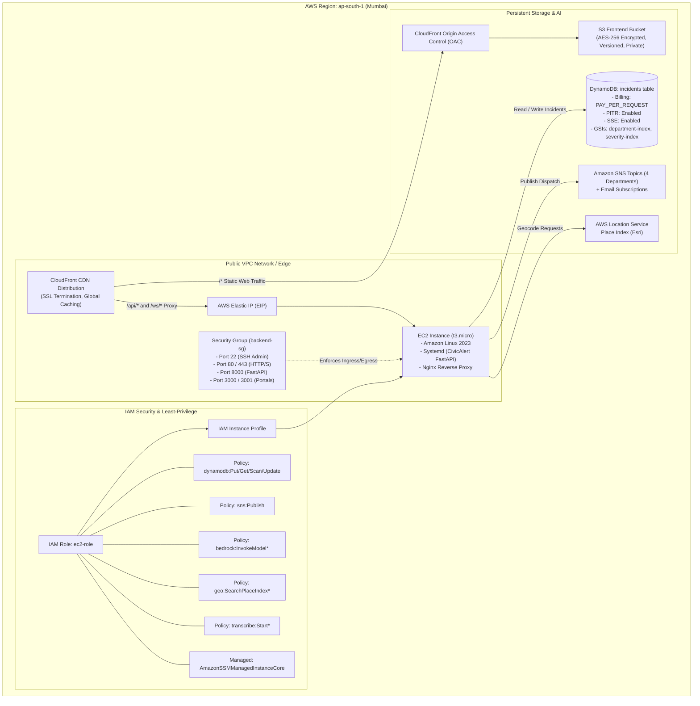

# 🏛️ CivicAlert System Architecture

> **Project:** CivicAlert — Voice-First AI-Powered Emergency Response System for India  
> **Event:** Techkriti 2026 AWS Builder Center Track  
> **Team:** Segionpex (`@jabhaskript`, `@geng4r`, `@blackadder45`)  
> **Target Latency:** Sub-10 seconds from civilian voice input to multi-department alert dispatch  

---

## 1. Executive Summary & System Overview

**CivicAlert** is a next-generation, voice-first emergency triage and dispatch system tailored for India's high-density, multilingual public safety ecosystem. In critical emergencies, typing detailed text, remembering distinct helpline numbers (100 for Police, 101 for Fire, 102/108 for Ambulance, 1070 for Disaster Management), or navigating complex interfaces costs vital minutes. 

CivicAlert eliminates these bottlenecks through a unified, one-touch interface:
1. **Civilians speak naturally** in their native language (English, Hindi, Tamil, Telugu, Bengali, Marathi).
2. **Sarvam AI Saaras v4** transcribes speech streams with high accuracy for Indian accents and regional languages.
3. **Amazon Bedrock (Claude 3.5 Sonnet / Claude Sonnet 4)** triages the situation: classifying emergency type, severity, trapped/injured casualties, extracting spoken landmarks, and determining the exact departmental forces required.
4. **AWS Location Service** validates and resolves coordinates (reverse geocoding GPS coordinates or forward geocoding landmarks extracted from speech).
5. **Amazon SNS** instantaneously broadcasts structured dispatch tickets to all relevant emergency agencies in parallel.
6. **Amazon DynamoDB** records the incident with millisecond latency, powering real-time department command dashboards and citywide hotspot analytics.
7. **Sarvam AI Bulbul v4 Flash** speaks a reassuring confirmation and dispatch summary back to the caller.

```
┌────────────────────────────────────────────────────────────────────────────────────────┐
│                               CivicAlert Mission Metric                                │
│       Voice Input ──▷ AI Triage ──▷ Geocode ──▷ DynamoDB ──▷ Multi-SNS Dispatch        │
│                                  ⏱️ < 10 SECONDS TOTAL                                  │
└────────────────────────────────────────────────────────────────────────────────────────┘
```

---

## 2. High-Level System Architecture

The following diagram illustrates the end-to-end architecture across Client, Edge/CDN, Compute, Database, AI Providers, and Dispatch layers:

```mermaid
flowchart TB
    subgraph Clients["Civilians & Emergency Dispatchers"]
        Civilian["Civilian Reporter (Mobile / Desktop Web)"]
        Dispatcher["Department Dispatcher (Command Dashboard)"]
        Analyst["City Safety Analyst (Hotspots & Metrics)"]
    end

    subgraph Edge["Edge & Delivery Layer (AWS Global Infrastructure)"]
        CF["Amazon CloudFront CDN (Global Edge POPs)"]
        OAC["CloudFront Origin Access Control (OAC)"]
        S3["Amazon S3 Static Bucket (Next.js 16 Web Assets)"]
    end

    subgraph Compute["Backend Compute Layer (AWS ap-south-1 Mumbai)"]
        EIP["AWS Elastic IP (Static Public IP)"]
        Nginx["Nginx Reverse Proxy (Port 80/443 SSL Termination)"]
        FastAPI["FastAPI App Server (Uvicorn 2 Workers, Port 8000)"]
        
        subgraph Services["Modular Service Layer"]
            S_Sarvam["sarvam.py\n(Saaras v4 STT + Bulbul v4 TTS)"]
            S_Bedrock["bedrock.py\n(Claude AI Triage Engine)"]
            S_Location["location.py\n(AWS Location Service)"]
            S_SNS["sns.py\n(Multi-Department Dispatcher)"]
            S_Dynamo["dynamodb.py\n(CRUD & Analytics Engine)"]
            S_Conv["conversation.py\n(Interactive Dispatch Turn Engine)"]
        end
    end

    subgraph ExternalAI["External & Specialized AI Engines"]
        SarvamSTT["Sarvam AI API: Saaras v4 (STT)"]
        SarvamTTS["Sarvam AI API: Bulbul v4 Flash (TTS)"]
        AnthropicDirect["Anthropic Messages API (Direct Fallback)"]
    end

    subgraph AWSServices["AWS Managed Services (ap-south-1)"]
        Bedrock["Amazon Bedrock\n(Claude Sonnet 4 / Claude 3.5 Sonnet / Nova Lite)"]
        LocationSvc["AWS Location Service\n(Place Index: Esri Data Source)"]
        DynamoDB[("Amazon DynamoDB\n(civic-alert-incidents-prod)\nGSIs: department-index, severity-index")]
        
        subgraph SNS["Amazon SNS Dispatch Topics"]
            SNS_Police["Police Alerts Topic"]
            SNS_Fire["Fire Department Topic"]
            SNS_Medical["Medical Emergency Topic"]
            SNS_Disaster["Disaster Response Topic"]
        end
    end

    subgraph FirstResponders["First Responder Force Dispatch"]
        R_Police["Police Control Room (PCR / Dial 112)"]
        R_Fire["Fire Brigade Stations"]
        R_Medical["Ambulance Fleet & ER Centers"]
        R_Disaster["NDRF / SDRF Disaster Response Teams"]
    end

    %% Client Routing
    Civilian -->|HTTPS & WSS Requests| CF
    Dispatcher -->|HTTPS Dashboard| CF
    Analyst -->|HTTPS Analytics| CF

    %% CloudFront Path Routing
    CF -->|Route '/*' (Static Web App)| OAC
    OAC --> S3
    CF -->|Route '/api/*' (REST Requests)| EIP
    CF -->|Route '/ws/*' (Real-time Audio Streams)| EIP

    %% Backend Flow
    EIP --> Nginx
    Nginx --> FastAPI
    FastAPI --> Services

    %% Service Connections
    S_Sarvam <-->|Audio PCM Chunks & TTS| SarvamSTT
    S_Sarvam <-->|Speech Synthesis| SarvamTTS
    S_Bedrock <-->|Converse API / Inference Profile| Bedrock
    S_Bedrock -.->|Optional Direct API Fallback| AnthropicDirect
    S_Location <-->|Forward / Reverse Geocoding| LocationSvc
    S_Dynamo <-->|PutItem, Scan, UpdateItem| DynamoDB
    S_SNS -->|Publish Alert Payload| SNS

    %% SNS Dispatch to Responders
    SNS_Police --> R_Police
    SNS_Fire --> R_Fire
    SNS_Medical --> R_Medical
    SNS_Disaster --> R_Disaster

    %% Polling
    Dispatcher -.->|Polls Incidents every 15s| CF
```

---

## 3. Architecture Layers in Detail

### 3.1 Frontend Layer (Next.js 16 + React 19 + TypeScript)

The client application is built with **Next.js 16.1.6** using the modern App Router architecture, fully compiled as a high-performance static export (`output: 'export'`) deployed to Amazon S3 and distributed globally through Amazon CloudFront.

#### Page Structure & Portals
* **Landing Page (`/`)**: 
  - Hero section highlighting the sub-10 second emergency mission.
  - Interactive emergency simulation allowing users to test audio scenarios.
  - Live preview of incident triage and automated department dispatch.
  - Technology breakdown covering AWS and Sarvam AI integrations.
* **Emergency Voice Report (`/report`)**:
  - One-touch audio recording button with pulsating radar waves.
  - Client-side microphone stream capture using the HTML5 **Web Audio API** (`AudioContext`, `ScriptProcessorNode`, `AnalyserNode`) at 16,000 Hz 16-bit mono PCM.
  - Real-time bidirectional WebSocket connection (`/ws/transcribe`) streaming raw PCM audio chunks.
  - Real-time frequency waveform rendering (30 animated equalizer bars).
  - Live streaming transcription cards updating as the caller speaks.
  - Geolocation acquisition via Browser Geolocation API (`enableHighAccuracy: true`).
  - Multilingual support selector across 6 languages: English (`en-IN`), Hindi (`hi-IN`), Tamil (`ta-IN`), Telugu (`te-IN`), Bengali (`bn-IN`), and Marathi (`mr-IN`).
  - Visual triage timeline: *Transcribing ➔ AI Reasoning ➔ Department Classification ➔ Alert Dispatch*.
  - Spoken response playback using synthesized audio from Sarvam Bulbul v4 Flash.
* **Command Dashboard (`/dashboard`)**:
  - Real-time incident feed polling `/api/incidents` every 15 seconds.
  - Interactive Leaflet map (`MapView.tsx`) with custom pin markers color-coded by emergency severity (Critical: Red, High: Amber, Medium: Blue, Low: Green).
  - Department filtering: All, Police, Fire Department, Medical Emergency, Disaster Response.
  - Status updates: Operators can mark active incidents as `responding` or `resolved` with instant optimistic UI updates (`PATCH /api/incidents/{id}/status`).
* **Analytics & Hotspot Intelligence (`/analytics`)**:
  - Aggregate statistics: Total incidents, active count, average response time, resolution rate.
  - Recharts visual charts: Incidents by Type (Bar chart), Severity Distribution (Donut chart).
  - City hotspot rankings identifying geographic concentration (e.g., Kanpur, Lucknow, Delhi, Mumbai).
  - Department workload distribution meters.
* **Agency Dedicated Portals (`/agencies`, `/agencies/[agency]`)**:
  - Distinct agency-tailored views (`/agencies/police`, `/agencies/fire`, `/agencies/medical`, `/agencies/disaster`).
  - Pre-filtered agency dashboards and localized response analytics.

#### Frontend UI & Visualization Libraries
| Library | Version | Purpose in CivicAlert |
|---|---|---|
| **Next.js** | `16.1.6` | App Router framework, static export optimization |
| **React / React DOM** | `19.2.3` | Concurrent rendering, hooks, reactive UI state |
| **Framer Motion** | `12.36.0` | Fluid animations, spring-physics micro-interactions, layout transitions |
| **Leaflet & React-Leaflet** | `1.9.4 / 5.0.0` | Interactive OpenStreetMap rendering, dynamic incident map markers |
| **Recharts** | `3.8.0` | Declarative SVG bar charts, donut charts, and responsiveness |
| **Lucide React** | `0.577.0` | Emergency iconography (Shield, Flame, Heart, CloudLightning, Mic) |
| **CSS Modules** | Native | Isolated scoping, CSS variables for dark-mode glassmorphic theme |

---

### 3.2 Backend Layer (Python FastAPI on AWS EC2)

The CivicAlert backend is an asynchronous Python 3.11 service built with **FastAPI** and hosted via **Uvicorn** (configured with 2 production worker processes). It operates on a **Service Layer Pattern** where external cloud and AI integrations are encapsulated behind clean service modules equipped with zero-dependency offline mock fallbacks.

```
backend/
├── main.py                     # API routing, WebSockets, request validation, CORS
├── mock_db.json                # Local persistent JSON database for development/fallback
├── requirements.txt            # Python dependencies (fastapi, uvicorn, boto3, aiohttp)
└── services/
    ├── sarvam.py               # Sarvam AI Saaras v4 STT + Bulbul v4 Flash TTS
    ├── bedrock.py              # Amazon Bedrock Claude triage & department matrix
    ├── location.py             # AWS Location Service forward & reverse geocoding
    ├── sns.py                  # Amazon SNS multi-department alert dispatcher
    ├── dynamodb.py             # DynamoDB CRUD, GSIs & analytics aggregation
    ├── transcribe.py           # Legacy Amazon Transcribe streaming + mock generators
    └── conversation.py         # Multi-turn voice dispatcher dialog engine
```

#### Detailed Service Modules

#### 1. `sarvam.py` — Speech-to-Text & Text-to-Speech
* **Speech-to-Text (Saaras v4)**:
  - Replaces standard STT with Sarvam's frontier Indic model `saaras:v4` optimized for 10+ Indian languages and code-mixed Indian English.
  - Streaming audio buffer: Collects 16kHz PCM chunks from the WebSocket. Every 10 seconds (`LIVE_SEGMENT_SECONDS`), it converts the segment into a WAV container and dispatches it to Sarvam's REST endpoint to stream back partial transcripts.
  - Final Pass: Upon recording completion, the backend concatenates the entire audio buffer and executes a definitive transcription pass (chunking segments at <= 28 seconds to comply with API boundaries), ensuring zero dropped phrases.
* **Text-to-Speech (Bulbul v4 Flash)**:
  - Synthesizes clear, calming audio summaries in the user's native language using `bulbul:v4-flash`.
  - Maps language codes to dedicated voice personas:
    - English (`en-IN`): `ritu_en_medical`
    - Hindi (`hi-IN`): `ritu_hi_medical`
    - Tamil (`ta-IN`): `gokul_ta_narration`
    - Telugu (`te-IN`): `tarun_te_narration`
    - Bengali (`bn-IN`): `roopa_bn_conversational`
    - Marathi (`mr-IN`): `ritu_mr_narration`
  - Returns `data:audio/mpeg;base64,...` for instant, latency-free browser playback.

#### 2. `bedrock.py` — AI Incident Triage Engine
* **Model Integration**: Invokes Amazon Bedrock via the AWS SDK `boto3` Converse API (`bedrock-runtime`).
  - Supported inference profiles & models:
    - `apac.anthropic.claude-sonnet-4-20250514-v1:0` (Sonnet 4 with Extended Thinking)
    - `apac.anthropic.claude-3-5-sonnet-20241022-v2:0` (Claude 3.5 Sonnet v2)
    - `anthropic.claude-3-sonnet-20240229-v1:0` (Claude 3 Sonnet)
    - `apac.amazon.nova-lite-v1:0` (Amazon Nova Lite)
* **Structured Data Extraction**:
  - `incident_type`: Specific classification (Building Fire, Road Accident, Gas Leak, Flooding, Theft, etc.).
  - `severity`: Standardized triage tier (`critical`, `high`, `medium`, `low`).
  - `casualties`: Exact count or state (`3 trapped, 2 burn injuries`, `None reported`).
  - `location_extracted`: Landmark or address explicitly extracted from the transcript text.
  - `department_reasoning`: Reasoning behind the department selection.
  - `summary`: 2-3 sentence structured briefing for first responders.
  - `confidence`: Confidence score normalized to a 0–100 scale.
* **Deterministic Department Dispatch Matrix**:
  To prevent AI hallucination or missed alerts during life-or-death situations, `bedrock.py` enforces regex-based keyword safety rules (`_enforce_department_rules`):
  - **Fire Department**: `fire`, `smoke`, `gas leak*`, `explosion`, `cylinder*`, `electrocution`, `आग`, `धुआं`
  - **Medical Emergency**: `injur*`, `trapped`, `unconscious*`, `bleed*`, `burn*`, `heart attack*`, `casualt*`
  - **Police**: `theft`, `robber*`, `assault*`, `weapon*`, `riot*`, `accident*`, `crash*`, `hit and run`
  - **Disaster Response**: `flood*`, `earthquake*`, `cyclone*`, `collapse*`, `chemical spill*`, `biohazard`, `बाढ़`
  - If multi-hazard signals are present (e.g., a car collision causing fire and injuries), alerts are dispatched to **all** applicable departments simultaneously.

#### 3. `location.py` — Geocoding & Reverse Geocoding
* Integrates with **AWS Location Service** using an Esri-backed Place Index (`civic-alert-places-prod`).
* **Forward Geocoding (`geocode`)**:
  - Takes natural speech locations (e.g., *"Sector 15, Kanpur"*).
  - Ignores generic conversational noise words (*"the bus stop"*, *"the road"*, *"here"*).
  - Uses `search_place_index_for_text` constrained to India (`FilterCountries: ["IND"]`) and biased toward the reporter's device GPS if available (`BiasPosition: [lng, lat]`).
* **Reverse Geocoding (`reverse_geocode`)**:
  - Converts raw browser GPS latitude/longitude coordinates into human-readable Indian street addresses using `search_place_index_for_position`.
  - Fallback: Returns raw coordinates if no exact address match is indexed, ensuring no fabricated locations.

#### 4. `sns.py` — Multi-Department Emergency Broadcast
* Dispatches formatted JSON alerts to AWS SNS topics configured for each department:
  - `civic-alert-police-alerts-prod`
  - `civic-alert-fire-alerts-prod`
  - `civic-alert-medical-alerts-prod`
  - `civic-alert-disaster-alerts-prod`
* Adds structured `MessageAttributes` for severity, incident type, and target department, enabling downstream subscriber filtering.
* Automatically triggers immediate email notifications to enrolled department control room addresses.

#### 5. `dynamodb.py` — Data Persistence & Analytics
* Stores incidents in Amazon DynamoDB table `civic-alert-incidents-prod`.
* Manages status lifecycle transitions: `active` ➔ `responding` ➔ `resolved`.
* Performs real-time analytics aggregation across all stored records:
  - Incident counts grouped by classification type.
  - Severity breakdown distributions.
  - Department workload distribution.
  - Geographic city hotspots extracted from address records.
* Built-in resiliency: Automatically falls back to atomic updates in `mock_db.json` if AWS credentials or table connections encounter issues.

---

### 3.3 Infrastructure Layer (Terraform & AWS Cloud)

CivicAlert’s entire cloud infrastructure is defined as declarative Infrastructure as Code (IaC) in Terraform (`terraform/` directory), allowing one-command reproducibility (`terraform apply`).



#### Terraform Resource Inventory

| Terraform File | AWS Resource | Purpose | Configuration Highlights |
|---|---|---|---|
| `ec2.tf` | `aws_instance.backend` | Backend FastAPI Host | `t3.micro`, Amazon Linux 2023, 30 GB gp3 encrypted storage |
| `ec2.tf` | `aws_eip.backend_eip` | Static Backend IP | Elastic IP attached to EC2 instance |
| `ec2.tf` | `aws_security_group.backend_sg` | Network Firewall | Ingress: 22, 80, 443, 8000, 3000, 3001; Egress: All |
| `dynamodb.tf` | `aws_dynamodb_table.incidents` | Incident Data Store | `PAY_PER_REQUEST` billing, PITR enabled, SSE-AES256 |
| `dynamodb.tf` | GSIs (2 secondary indexes) | Fast Query Lookups | `department-index` and `severity-index` (Range: timestamp) |
| `sns.tf` | `aws_sns_topic` (4 topics) | Alert Broadcasting | Dedicated topics for Police, Fire, Medical, Disaster |
| `sns.tf` | `aws_sns_topic_subscription` | Notification Alerts | Configurable Email endpoints (`alert_email`) |
| `location.tf` | `aws_location_place_index.places` | Map Address Lookup | `civic-alert-places-prod`, Data Source: `Esri` |
| `s3_cloudfront.tf` | `aws_s3_bucket.frontend` | Static Web Storage | Encrypted, versioned, public access blocked |
| `s3_cloudfront.tf` | `aws_cloudfront_origin_access_control` | S3 Secure Link | OAC SigV4 restricted S3 bucket access |
| `s3_cloudfront.tf` | `aws_cloudfront_distribution` | Global Reverse Proxy | S3 static hosting + `/api/*` and `/ws/*` EC2 reverse proxy |
| `iam.tf` | `aws_iam_role.ec2_role` | Instance Identity | Least-privilege IAM policies for DynamoDB, SNS, Bedrock |
| `user_data.sh` | Shell Bootstrap Script | Automated Setup | Configures Python 3.11, Nginx, systemd service on boot |

#### Automated EC2 Provisioning (`user_data.sh`)
When the EC2 instance launches, `user_data.sh` executes the following sequence:
1. Updates package repositories via `dnf update -y`.
2. Installs Python 3.11, pip, git, and Nginx.
3. Creates a dedicated service user `civicalert`.
4. Clones the deployment repository branch into `/opt/civicalert`.
5. Establishes a Python virtual environment and installs dependencies from `requirements.txt`.
6. Dynamically renders `/opt/civicalert/.env` containing AWS resource ARNs and region config.
7. Registers a systemd unit `/etc/systemd/system/civicalert.service` running Uvicorn on port 8000.
8. Configures Nginx (`/etc/nginx/conf.d/civicalert.conf`) with HTTP/1.1 WebSocket upgrade headers.
9. Enables and starts both `civicalert` and `nginx` system services.

---

## 4. End-to-End Emergency Data Flow

The lifecycle of an emergency report follows a pipeline engineered for sub-10-second completion:

```mermaid
sequenceDiagram
    autonumber
    actor Civilian as Civilian Reporter
    participant Browser as Browser Client (Next.js)
    participant CF as CloudFront CDN
    participant FastAPI as Backend (EC2 FastAPI)
    participant Sarvam as Sarvam AI (Saaras v4)
    participant Bedrock as Amazon Bedrock (Claude)
    participant Location as AWS Location Service
    participant DynamoDB as Amazon DynamoDB
    participant SNS as Amazon SNS
    actor Responders as Department Responders

    Civilian->>Browser: Opens /report, taps Mic button
    Browser->>Browser: Requests Mic (Web Audio API) & GPS coords
    Browser->>CF: Open WebSocket /ws/transcribe
    CF->>FastAPI: Upgrade to WebSocket
    FastAPI-->>Browser: Handshake complete {"type": "ready"}

    rect rgb(20, 30, 45)
        Note over Browser,FastAPI: Real-time Audio Streaming Loop
        loop Every ~100ms
            Browser->>FastAPI: Binary PCM16 audio chunks (16 kHz mono)
        end
        loop Every 10 seconds
            FastAPI->>Sarvam: Transcribe live segment (WAV)
            Sarvam-->>FastAPI: Segment transcript
            FastAPI-->>Browser: JSON {"type": "transcript", "text": "...", "is_partial": true}
            Browser->>Civilian: Displays live text & animated waveform
        end
    end

    Civilian->>Browser: Taps Stop Recording
    Browser->>FastAPI: Send {"type": "stop"}
    FastAPI->>Sarvam: Final full-recording transcription pass
    Sarvam-->>FastAPI: Final consolidated transcript text
    FastAPI-->>Browser: Final transcript + {"type": "done"}

    rect rgb(30, 25, 40)
        Note over Browser,Responders: AI Triage & Parallel Dispatch Pipeline
        Browser->>FastAPI: POST /api/report {transcript, language, coordinates}
        
        par AI Triage & Classification
            FastAPI->>Bedrock: Converse API (Claude Sonnet 4 with Extended Thinking)
            Bedrock-->>FastAPI: {type, severity, casualties, departments, location_extracted, summary}
        and Forward Geocoding (if location mentioned)
            FastAPI->>Location: search_place_index_for_text(location_extracted, bias_near)
            Location-->>FastAPI: Verified Coordinates (lat, lng)
        end

        FastAPI->>Location: search_place_index_for_position(coords)
        Location-->>FastAPI: Verified Street Address

        FastAPI->>FastAPI: Enforce Department Safety Rules & Generate INC-UUID

        par Persist Incident Record
            FastAPI->>DynamoDB: PutItem (incident_id, timestamp, severity, departments, etc.)
            DynamoDB-->>FastAPI: ACK (200 OK)
        and Dispatch Alerts
            FastAPI->>SNS: Publish alert payload to matched Department Topics
            SNS-->>Responders: Broadcast SMS / Email / Webhook / Pager
            SNS-->>FastAPI: Dispatch Message IDs
        end
    end

    FastAPI-->>Browser: Return 200 OK with complete Incident object
    Browser->>Civilian: Display Incident Card & Department Badges
    
    opt Spoken Feedback
        Browser->>FastAPI: POST /api/tts {text: summary, language}
        FastAPI->>Sarvam: Bulbul v4 Flash TTS
        Sarvam-->>FastAPI: Base64 audio data URL
        FastAPI-->>Browser: Return audio data
        Browser->>Civilian: Plays spoken dispatch confirmation
    end

    loop Every 15 seconds
        Responders->>FastAPI: GET /api/incidents
        FastAPI->>DynamoDB: Scan / Query with department/severity filter
        DynamoDB-->>FastAPI: Incident Records
        FastAPI-->>Responders: Render live map pins & active queue
    end
```



---

## 5. AI Provider Configuration Matrix

CivicAlert is engineered to operate seamlessly across three different AI execution environments:

```mermaid
flowchart TD
    Start["FastAPI receives Incident Transcript"] --> CheckMock{"Is USE_MOCK == true?"}
    
    CheckMock -->|Yes| MockFlow["Keyword-based Mock Engine\n(Zero external calls, instant local testing)"]
    
    CheckMock -->|No| CheckAnthropic{"Is USE_ANTHROPIC_API == true?"}
    
    CheckAnthropic -->|Yes| AnthropicFlow["Anthropic Messages API\nModel: claude-3-sonnet-20240229\n(Direct API Key authentication)"]
    
    CheckAnthropic -->|No| BedrockFlow["AWS Bedrock Converse API\n(Claude Sonnet 4 / Claude 3.5 Sonnet / Nova Lite)\n(IAM Role or AWS Credentials)"]
    
    BedrockFlow --> CheckSuccess{"Did Bedrock call succeed?"}
    AnthropicFlow --> CheckSuccess
    
    CheckSuccess -->|Yes| SafetyRules["Enforce Mandatory Department Rules\n(_enforce_department_rules)"]
    CheckSuccess -->|No (Timeout / Quota / Network)| FallbackFlow["Keyword & Regex Fallback Engine\n(_keyword_fallback)\n(Honest extraction, no fabrication)"]
    
    MockFlow --> Output["Structured Incident JSON"]
    SafetyRules --> Output
    FallbackFlow --> Output
```

### Environment Configuration Settings

| Mode | Environment Variables | Description | Ideal Use Case |
|---|---|---|---|
| **1. Local Mock Mode** | `USE_MOCK=true` | Zero cloud dependencies; uses deterministic keyword matching and local `mock_db.json`. | Local UI development, frontend testing, offline hackathons |
| **2. AWS Bedrock Mode** | `USE_MOCK=false`<br>`USE_ANTHROPIC_API=false`<br>`BEDROCK_MODEL_ID=...` | Production setup invoking Bedrock foundation models via IAM instance profile. | Production AWS deployment, high security, AWS credits |
| **3. Direct Anthropic Mode** | `USE_MOCK=false`<br>`USE_ANTHROPIC_API=true`<br>`ANTHROPIC_API_KEY=sk-ant-...` | Direct calls to Anthropic's Messages endpoint bypassing Bedrock permissions. | Staging environments, accounts awaiting Bedrock model access grants |

#### Supported Bedrock Model Identifiers
* `apac.anthropic.claude-sonnet-4-20250514-v1:0`: **Claude Sonnet 4** with extended thinking budget (3,000 tokens) for deep casualty reasoning.
* `apac.anthropic.claude-3-5-sonnet-20241022-v2:0`: **Claude 3.5 Sonnet v2** via APAC Cross-Region Inference Profile.
* `anthropic.claude-3-sonnet-20240229-v1:0`: **Claude 3 Sonnet** on-demand model.
* `apac.amazon.nova-lite-v1:0`: **Amazon Nova Lite**, low-latency model available on-demand across all AWS accounts.

---

## 6. Security, Resilience & High Availability

### 6.1 Network & IAM Security
* **Origin Access Control (OAC)**: The S3 frontend bucket blocks all direct public internet access. Static assets can only be retrieved via authenticated SigV4 requests initiated by CloudFront.
* **Least-Privilege IAM Roles**: The backend EC2 instance assumes an IAM Role (`civic-alert-ec2-role-prod`) granting strictly scoped permissions:
  - DynamoDB access limited specifically to `civic-alert-incidents-prod` and its GSIs.
  - SNS publishing restricted to the 4 defined departmental topic ARNs.
  - AWS Location access restricted to `civic-alert-places-prod`.
  - Bedrock model invocations limited to foundation and inference profile models.
* **Network Segregation**: CloudFront handles edge HTTPS termination with modern TLS 1.2/1.3 ciphers, shielding the backend server from direct public DDoS exposure.

### 6.2 Fail-Safe Mechanisms
* **Department Dispatch Safeguard**: If an AI model hallucinates or fails to mention an obvious service (e.g. failing to route a severe fire with trapped occupants to Medical), deterministic regex rules automatically append the required department force before the alert is published.
* **Graceful Degradation (`_MOCK_FORCED`)**: If DynamoDB encounters temporary AWS credential or throttling errors, `dynamodb.py` automatically activates an internal circuit breaker, persisting records to `mock_db.json` so no civilian reports are ever lost.
* **Honest Location Fallback**: The system never fabricates placeholder addresses. If GPS coordinates are unavailable and speech contains no identifiable landmark, the report is explicitly recorded as `"Unknown location"`, alerting operators to initiate location tracing.

---

## 7. Deployment & Operations

### 7.1 Infrastructure Provisioning
```bash
# Initialize and apply Terraform
cd terraform
cp terraform.tfvars.example terraform.tfvars
terraform init
terraform plan
terraform apply -auto-approve
```

### 7.2 Frontend Deployment & Cache Invalidation
```bash
# Automated deployment script
npm run deploy

# Or manual deployment using AWS CLI:
echo "NEXT_PUBLIC_API_URL=http://<BACKEND_EC2_IP>:8000" > .env.local
npm run build
aws s3 sync out/ s3://<FRONTEND_S3_BUCKET> --delete
aws cloudfront create-invalidation --distribution-id <DISTRIBUTION_ID> --paths "/*"
```

### 7.3 Backend Service Operations
```bash
# Inspect systemd backend status
sudo systemctl status civicalert.service

# View live application logs
sudo journalctl -u civicalert.service -f

# Verify Nginx reverse proxy
sudo systemctl status nginx
```

---

## 8. Summary of Technical Specifications

| Parameter | Specification |
|---|---|
| **Primary Region** | `ap-south-1` (Asia Pacific - Mumbai) |
| **Target Latency** | Voice capture to alert dispatch: **< 10 seconds** |
| **Supported Languages** | English (`en-IN`), Hindi (`hi-IN`), Tamil (`ta-IN`), Telugu (`te-IN`), Bengali (`bn-IN`), Marathi (`mr-IN`) |
| **STT Engine** | Sarvam AI Saaras v4 (`saaras:v4`) |
| **TTS Engine** | Sarvam AI Bulbul v4 Flash (`bulbul:v4-flash`) |
| **AI Triage Model** | Amazon Bedrock Claude Sonnet 4 / Claude 3.5 Sonnet / Amazon Nova Lite |
| **Geocoding Engine** | AWS Location Service (Esri Place Index) |
| **Database** | Amazon DynamoDB (On-Demand Capacity, PITR enabled) |
| **Alerting** | Amazon SNS (4 Departmental Topics + Email Subscriptions) |
| **Frontend CDN** | Amazon CloudFront + Amazon S3 (OAC SigV4) |
| **Backend Compute** | Amazon EC2 (t3.micro, Amazon Linux 2023, Uvicorn 2 workers) |
| **IaC Tool** | Terraform (HashiCorp AWS Provider ~> 5.0) |
